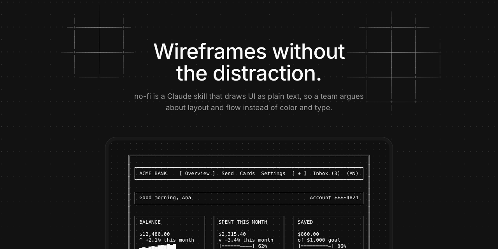

# no-fi

A Claude skill that draws UI as plain text, so a team argues about layout and flow instead of color and type.

- `no-fi/`: the skill. `SKILL.md` holds the rules, `vocabulary.json` the element vocabulary, `examples/` real screens, and `scripts/` the wireframe and coverage checks.
- `site/`: the static Next.js page that explains the skill. See `site/README.md`.
